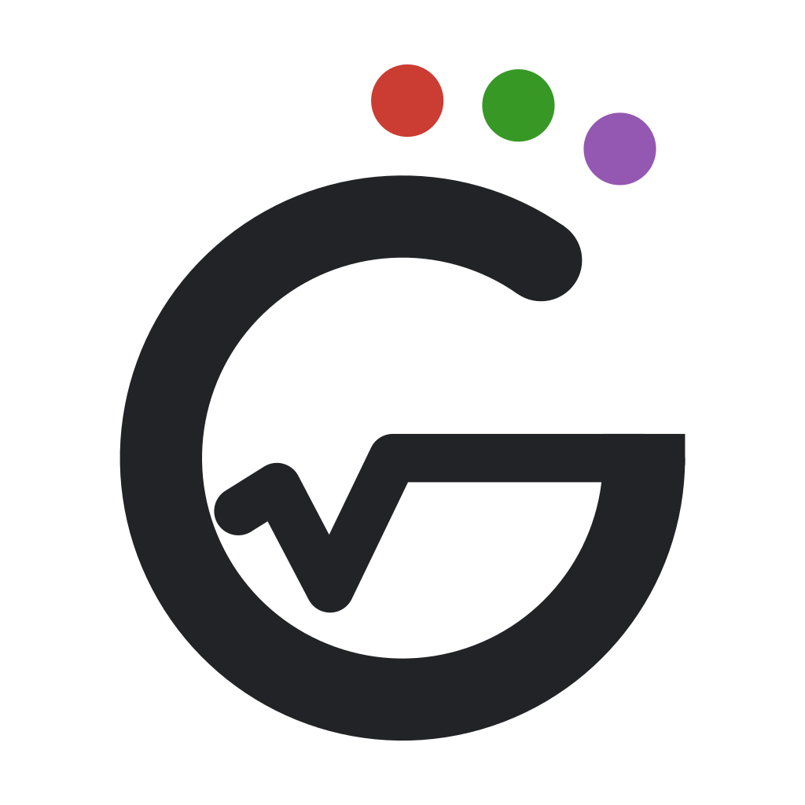

# JuliaGiac site kit

<p align="center">
  <picture>
    <source media="(prefers-color-scheme: dark)" srcset="brand/assets/juliagiac-mark-light.svg">
    
  </picture>
</p>

The parts the [JuliaGiac](https://juliagiac.github.io/) web sites share: the
visual identity, the Hugo templates and styles, and the Documenter styles.
This repository is their single source; each site keeps copies, which
`sync.jl` writes and checks.

| Path | What | Used by |
|---|---|---|
| `brand/` | The mark, avatar, favicons and social preview, generated by `brand/make_brand.jl` (Luxor.jl); palette in [`brand/README.md`](brand/README.md) | everything |
| `hugo/` | Page templates for project sites, `style.css`, `syntax.css` | [juliagiac.github.io](https://github.com/JuliaGiac/juliagiac.github.io) (styles only), [giac](https://github.com/JuliaGiac/giac) `site/`, [libgiac-julia-wrapper](https://github.com/JuliaGiac/libgiac-julia-wrapper) `site/` |
| `documenter/` | `juliagiac.css` for Documenter + DocumenterLandingPage | [Giac.jl](https://github.com/JuliaGiac/Giac.jl), [GiacSlate.jl](https://github.com/JuliaGiac/GiacSlate.jl) |

## Updating a site

Change the file here, then copy it into each site, one pull request per
repository:

```sh
julia sync.jl hugo-home      ../juliagiac.github.io
julia sync.jl hugo-project   ../giac/site
julia sync.jl hugo-project   ../libgiac-julia-wrapper/site
julia sync.jl documenter     ../Giac.jl/docs
julia sync.jl documenter     ../GiacSlate.jl/docs --keep-logo
```

`--check` changes nothing and exits with status 1 if a copy is missing or out
of date, so a site's CI can run it. Copied CSS and templates start with a
"Managed by JuliaGiac/site-kit" line: edit them here, not in the copy.

What each kind receives:

- **`hugo-home`:** `static/style.css`, `static/syntax.css` and the brand
  images in `static/img/`. The home page keeps its own templates.
- **`hugo-project`:** the same, plus `layouts/_default/baseof.html`,
  `layouts/_default/single.html` and `layouts/index.html`. The site provides
  `hugo.toml` (title, tagline as `params.description`, `[menus.main]`, and
  `[markup.highlight] noClasses = false`), `layouts/partials/footer.html` and
  its content.
- **`documenter`:** `src/assets/juliagiac.css`, `src/assets/favicon.png` and,
  unless `--keep-logo`, the mark as `src/assets/logo.svg` and `logo-dark.svg`.
  In `docs/make.jl`:

  ```julia
  format = Documenter.HTML(;
      assets = ["assets/juliagiac.css",
                asset("assets/favicon.png", class = :ico, islocal = true)],
      footer = "Part of [JuliaGiac](https://juliagiac.github.io/), which brings " *
               "[Giac](https://www-fourier.univ-grenoble-alpes.fr/~parisse/giac.html) " *
               "(Bernard Parisse and Renée De Graeve) to Julia.",
  )
  ```

  and an "All JuliaGiac projects" action linking to
  `https://juliagiac.github.io/` in the landing page hero.

## The identity

```sh
just brand   # regenerate brand/assets/ after changing brand/make_brand.jl
```

The mark is a G whose crossbar is the overline of a square root sign, with
the three Julia dots above its opening. See [`brand/README.md`](brand/README.md).
Giac and Xcas are by Bernard Parisse and Renée De Graeve, Institut Fourier,
Université Grenoble Alpes; JuliaGiac is an independent project.
